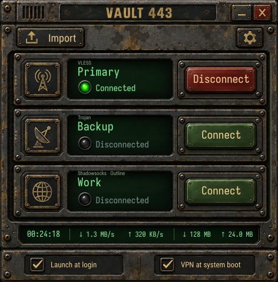
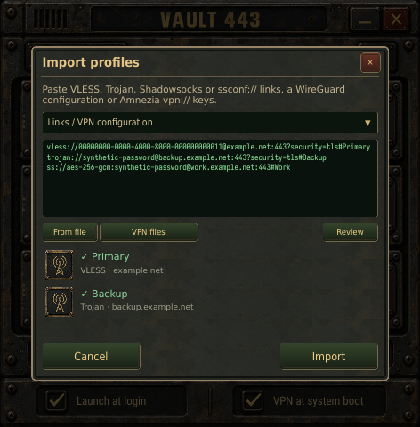
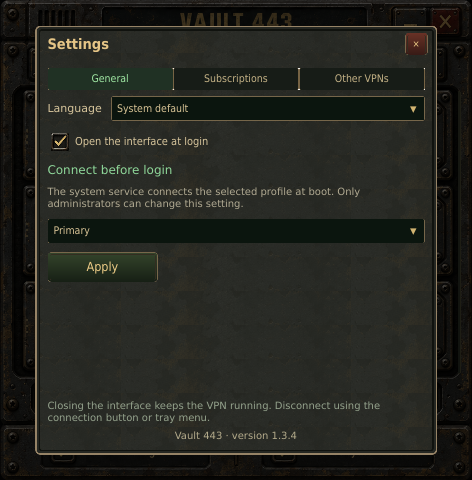
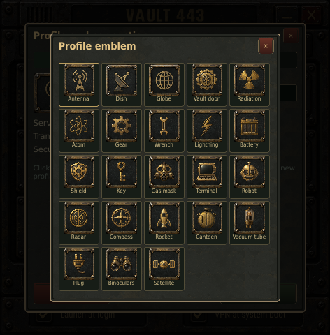
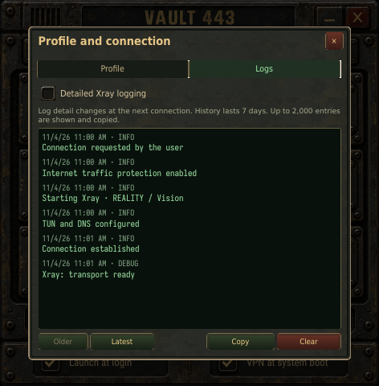
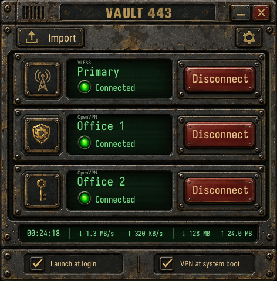
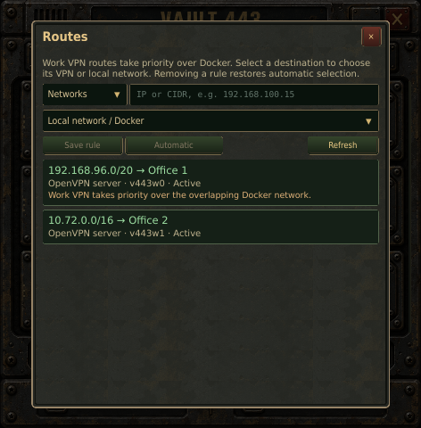
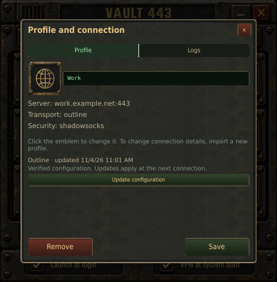
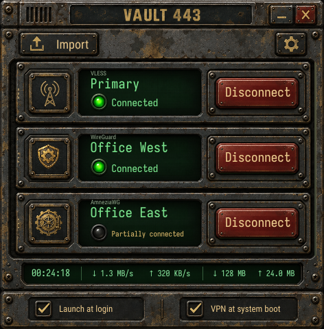
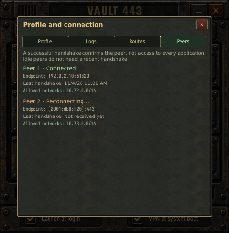

<p align="center">
  
</p>
<h1 align="center">Vault 443</h1>
<p align="center"><strong>A Linux VPN client with a Fallout-inspired retro interface.</strong></p>
<p align="center"><strong>English</strong> · <a href="README.ru.md">Русский</a></p>
<p align="center"><a href="https://realleo.github.io/vault443/"><strong>Explore the interactive Vault 443 console</strong></a></p>
<p align="center">
  Import your profiles, connect with a click, and manage your internet and work VPNs in one compact native desktop app.<br>
  VLESS, Trojan, Shadowsocks/Outline, OpenVPN, WireGuard and AmneziaWG.<br>
  Bring your own server or subscription. No Vault 443 account required.
</p>
<p align="center">
  
  
  
  <a href="LICENSE"></a>
</p>
<p align="center">
  <a href="https://github.com/RealLeo/vault443/releases/download/1.3.4/vault443_1.3.4-1ubuntu24.04_amd64.deb"><strong>Download for Ubuntu</strong></a> ·
  <a href="#download">Other distributions</a> ·
  <a href="#install">Install</a> ·
  <a href="#first-connection">Get started</a> ·
  <a href="#working-alongside-other-vpns">Other VPNs</a> ·
  <a href="#build-from-source">Build</a> ·
  <a href="docs/RELEASE-1.3.4.md">What's new</a>
</p>
<p align="center">
  <a href="docs/images/readme/main.png"></a>
</p>
<p align="center"><em>A compact 472 × 480 window. Real controls, live status, no browser runtime.</em></p>

## Your connections, in one place

- **Bring your own profiles.** Import links, files or HTTPS subscriptions for VLESS, Trojan and Shadowsocks/Outline. Review profiles before saving; subscription updates keep your choices.
- **Manage internet and work VPNs.** Add supported OpenVPN, WireGuard or AmneziaWG profiles and choose how overlapping work and Docker networks are routed. Split work routes can run alongside your main internet connection; a full-tunnel work VPN pauses it.
- **Know what is happening.** See connection progress, live traffic and per-profile logs. The network guard blocks direct internet traffic during an unexpected outage; an explicit **Disconnect** restores ordinary routing.

A valid server configuration or subscription is required. Vault 443 is a client, not a VPN service. [Supported profiles](docs/backend.md#supported-imports) · [Work VPN limits](docs/work-vpn.md).

## Download

**Vault 443 1.3.4 · Linux x86-64 (amd64).** Choose the package for your distribution; Ubuntu and Debian packages are separate builds.

| Distribution | Installer | Checksum |
| --- | --- | --- |
| Ubuntu 24.04 / 26.04 | [Download .deb](https://github.com/RealLeo/vault443/releases/download/1.3.4/vault443_1.3.4-1ubuntu24.04_amd64.deb) | [SHA-256](https://github.com/RealLeo/vault443/releases/download/1.3.4/vault443_1.3.4-1ubuntu24.04_amd64.deb.sha256) |
| Debian 13 | [Download .deb](https://github.com/RealLeo/vault443/releases/download/1.3.4/vault443_1.3.4-1debian13_amd64.deb) | [SHA-256](https://github.com/RealLeo/vault443/releases/download/1.3.4/vault443_1.3.4-1debian13_amd64.deb.sha256) |
| Fedora 44 · initial port | [Download .rpm](https://github.com/RealLeo/vault443/releases/download/1.3.4/vault443-1.3.4-1.fc44.x86_64.rpm) | [SHA-256](https://github.com/RealLeo/vault443/releases/download/1.3.4/vault443-1.3.4-1.fc44.x86_64.rpm.sha256) |
| Arch Linux · initial port | [Download .pkg.tar.zst](https://github.com/RealLeo/vault443/releases/download/1.3.4/vault443-1.3.4-1-x86_64.pkg.tar.zst) | [SHA-256](https://github.com/RealLeo/vault443/releases/download/1.3.4/vault443-1.3.4-1-x86_64.pkg.tar.zst.sha256) |

[All release files and build manifests](https://github.com/RealLeo/vault443/releases/tag/1.3.4) · [SHA256SUMS](https://github.com/RealLeo/vault443/releases/download/1.3.4/SHA256SUMS) · [What's new](docs/RELEASE-1.3.4.md).

Ubuntu is the established desktop target. Fedora/Arch are initial ports; physical desktop, boot/suspend and Fedora enforcing SELinux/firewalld acceptance remain pending. These are unsigned project packages, not official distribution repository packages. See [requirements and validation limits](docs/linux-packages.md).

## Install

1. Download the installer and its matching `.sha256` file from the table above. Open a terminal in the folder containing both files, as your **normal desktop user**.
2. Verify the package before installing. For Ubuntu:

   ```sh
   sha256sum -c vault443_1.3.4-1ubuntu24.04_amd64.deb.sha256
   ```

   It must report `OK`. For another distribution, use that installer's `.sha256` filename. Alternatively, download [SHA256SUMS](https://github.com/RealLeo/vault443/releases/download/1.3.4/SHA256SUMS) into the same folder and run `sha256sum --ignore-missing -c SHA256SUMS`; check that your package reports `OK`.
3. Use the command for your distribution:

   ```sh
   # Ubuntu 24.04 / 26.04
   sudo apt install ./vault443_1.3.4-1ubuntu24.04_amd64.deb

   # Debian 13
   sudo apt install ./vault443_1.3.4-1debian13_amd64.deb

   # Fedora 44
   sudo dnf install ./vault443-1.3.4-1.fc44.x86_64.rpm

   # Arch Linux: perform a full system upgrade first
   sudo pacman -Syu
   sudo pacman -U ./vault443-1.3.4-1-x86_64.pkg.tar.zst
   ```

4. Before the first connection, ensure your system uses **systemd-resolved**: `systemctl is-active systemd-resolved` must report `active`, and `resolvectl status` must show your network configuration. The supported stack is systemd, D-Bus/logind and systemd-resolved with NetworkManager or systemd-networkd. Kernel WireGuard and `/dev/net/tun` must be available. The installer does not migrate your DNS configuration; follow the [distribution prerequisites](docs/linux-packages.md#dns-and-desktop-prerequisites) if needed.
5. On a fresh **Fedora or Arch** install, enable the services after preparing DNS:

   ```sh
   sudo systemctl enable --now vault443-guard.service vault443.service
   ```

6. Grant your desktop user access once, then open **Vault 443** from the application launcher:

   ```sh
   sudo vault443-access "$USER"
   ```

The GUI runs as your regular user. An active local desktop session is required; do not launch the GUI with `sudo`. Existing users keep their access permissions. GNOME's tray icon needs StatusNotifier/AppIndicator support; the launcher can reopen the window without a tray host.

### First connection

1. Open **Import**, paste one or more `vless://`, `trojan://`, `ss://` or `ssconf://` links or choose a text file, then review the profiles and select their emblems. Add an HTTPS subscription from **Settings → Subscriptions**.
2. Click **Connect**. The line below the profile name shows progress, recovery attempts, or a specific error. Click it to open diagnostics.
For an ordinary HTTPS dynamic Outline URL, select **Outline · HTTPS / ssconf://** in the import dialog. Use **Update configuration** in profile properties to refresh manually; an active connection keeps its current configuration.

Click the profile emblem to rename it, choose another emblem, or open **Logs**. Detailed logging takes effect on the next connection.

In **Settings → General**, choose **System default**, **English**, or **Русский**. System default uses the first supported language in your system preferences and falls back to English. The choice is saved per user and applies immediately, including the tray.

| Startup option | What it does |
| --- | --- |
| Launch the interface at login | Opens the GUI when this user signs in. It does not select a boot VPN profile. |
| Connect VPN at system boot | Starts the selected system profile before desktop login. Requires an authorized administrator. |

One owner controls the active set of connections: one main Internet session (VLESS, Trojan or Shadowsocks/Outline) and up to 16 work sessions shared by OpenVPN, WireGuard and AmneziaWG. Each user has a private profile library and journal. Operator access requires an active local desktop session. Boot autoconnect applies to the selected main Internet profile; work profiles start manually. Boot-profile and manual VPN binding changes additionally require membership in `sudo`, `admin` or `wheel`.

## Daily use

Arrange mixed profile types by dragging the brass dots beside each emblem. The order is saved per user. Closing the window leaves connections running; reopen it from the launcher or use the tray. Session time, speeds and transfer totals persist while the GUI is closed and during automatic recovery.

Attached LANs and verified work routes retain their paths. IPv4 and IPv6 are checked separately; unavailable tunnel IPv6 fails quickly so applications can fall back to IPv4. Each user has a private profile library and journal. Journals retain up to seven days; detailed logging can be enabled per profile.

## A closer look

<table>
  <tr>
    <td align="center"><a href="docs/images/readme/import.png"></a><br><strong>Review before importing</strong></td>
    <td align="center"><a href="docs/images/readme/settings.png"></a><br><strong>Your language, your startup</strong></td>
  </tr>
  <tr>
    <td align="center"><a href="docs/images/readme/icons.png"></a><br><strong>Give each profile an emblem</strong></td>
    <td align="center"><a href="docs/images/readme/logs.png"></a><br><strong>Follow every connection</strong></td>
  </tr>
</table>

<table>
  <tr>
    <td align="center"><a href="docs/images/readme/work-vpns.png"></a><br><strong>Internet and work, together</strong></td>
    <td align="center"><a href="docs/images/readme/work-routes.png"></a><br><strong>Resolve overlapping networks</strong></td>
  </tr>
</table>

<p align="center"><a href="docs/images/readme/outline.png"></a><br><strong>Dynamic Outline sources</strong></p>

All screenshots use the application's demo mode and contain fictional profiles.

<table>
  <tr>
    <td align="center"><a href="docs/images/readme/wireguard.png"></a><br><strong>Choose your protocol</strong></td>
    <td align="center"><a href="docs/images/readme/peers.png"></a><br><strong>Understand every peer</strong></td>
  </tr>
</table>

## Work VPN profiles

Choose **Import**, select work profile files or paste a WireGuard/AmneziaWG configuration or autonomous `vpn://` key, review the detected profiles, choose their emblems, and save. Each card has its own **Connect**, **Cancel**, and **Disconnect** action. Work VPNs start manually; closing the GUI does not disconnect them. They recover after a network interruption or service restart in the same OS boot, but do not start automatically after reboot.

OpenVPN accepts certificate-based TUN profiles with inline CA, client certificate, private key, and optional `tls-auth` / `tls-crypt`. Passwords, encrypted private keys, MFA/SSO, external credential files, TAP, user scripts and plugins are not supported. An unsupported directive produces a specific import error instead of being silently ignored.

WireGuard uses the Linux kernel; AmneziaWG uses a bundled Go engine with private control sockets. Both accept client profiles with one or more peers, IPv4/IPv6, PSK, DNS and MTU settings. AmneziaWG parameters through 3.1 are retained. A successful handshake is required before a peer is connected; one unavailable peer does not disconnect the others. The **Peers** tab shows endpoints, last handshakes and protected networks. Autonomous Amnezia exports are decoded locally; Premium/Free API subscriptions and server administration keys are not supported.

Open **Settings → Other VPNs → Routes** to inspect received networks, overlaps and DNS zones. Work routes take precedence over overlapping Docker networks. A rule can select a work profile for an IP/CIDR, or preserve access to an existing local/Docker subnet. If two work profiles claim the same prefix or DNS zone, select the intended provider explicitly. Physical Internet bypass rules are not allowed.

The bottom traffic panel continues to measure **the current main Internet connection only**. Per-work-profile diagnostics show its interface, routes, DNS and connection stages. During an unexpected work VPN outage, its known destinations stay blocked until recovery; **Disconnect** releases that profile's protection.

| Work routing | Behavior |
| --- | --- |
| Specific work networks | Work VPN carries those networks; The main connection continues to carry Internet traffic. |
| Work subnet overlaps Docker | Work route wins automatically; the Routes window can preserve selected local destinations. |
| Same prefix or DNS zone claimed twice | Existing choice is retained; the conflict is displayed for explicit resolution. |
| Full Internet tunnel | The main connection pauses and resumes when the full tunnel is released. |

[Work VPN details and limitations](docs/work-vpn.md).

## Working alongside other VPNs

Connect Pritunl normally, then open **Settings → Other VPNs**. Automatically verified tunnels need no manual binding. Vault 443 also recognizes supported NetworkManager, systemd OpenVPN, and WireGuard connections from process and interface metadata.

| Other VPN's routing | Vault 443 behavior |
| --- | --- |
| Work networks only, such as a split-tunnel Pritunl profile | Work routes stay with Pritunl; The main connection carries Internet traffic. |
| All Internet traffic, such as a full-tunnel Pritunl profile | The requested main connection pauses. Internet stays on the verified other VPN; it resumes when those routes are released. |
| Tunnel identity cannot be verified | Diagnostics explains the problem. An administrator can use the advanced manual binding form for a supported custom tunnel. |

The application does not rewrite Pritunl settings or force it into split-tunnel mode. Verification is repeated when the network changes; a reused name such as `tun0` never grants trust by itself. Corporate DNS suffixes may need explicit configuration in the compatibility settings. Ordinary physical unicast DNS is blocked while protection is active; local IP access and mDNS remain available.

## Under the hood

| Layer | Responsibility |
| --- | --- |
| **Qt 6 Quick / QML · C++20** | Native window, textured controls, translations, tray, and asynchronous D-Bus client. No root GUI or Go–Qt bindings. |
| **Go system service** | Authenticated per-user profile access, subscriptions, connection lifecycle, recovery, and journal storage. |
| **OpenVPN 2.6+ · distribution package** | Managed certificate-based work tunnels, private management sockets and validated route/DNS events. |
| **WireGuard · Linux kernel** | Managed encrypted work interfaces and peer handshakes; no `wg-quick` scripts. |
| **AmneziaWG · separate Go process** | Pinned protocol implementation through 3.1 with a private Unix control socket. |
| **Xray-core · separate process** | VLESS, Trojan, Shadowsocks AEAD/2022, supported transports, and TUN traffic. |
| **Outline SDK · separate Go adapter** | Extended Outline transports through private authenticated SOCKS; no route or DNS ownership. |
| **systemd · nftables · systemd-resolved** | Boot startup, application-owned routes and traffic guard, and DNS integration. |

The guard remains active if Xray or the supervisor crashes. **Disconnect** is the explicit way to release it. When boot autoconnect is configured, an early guard runs before NetworkManager or systemd-networkd; other network managers are outside the validated boot contract.

Main connection checks use certificate-verified HTTPS through the tunnel. Work status confirms protocol establishment and routing; it cannot establish application authorization to every work server. Per-profile journals redact known credentials and retain at most **7 days / 10 MiB per profile / 50 MiB per user**. Xray access logging stays disabled. See the [service design](docs/backend.md) and [D-Bus contract](docs/interfaces.md) for details.

## Build from source

The build scripts fetch a checksum-pinned private **Go 1.27.3**; system Go is not used or replaced. Use CMake **3.21+**, a C++20 compiler, Ninja, and Qt **6.4+**. On Ubuntu 24.04, install the native build dependencies:

```sh
sudo apt install build-essential cmake ninja-build pkg-config python3 \
  qt6-base-dev qt6-declarative-dev qt6-l10n-tools qt6-wayland qt6-qpa-plugins \
  qml6-module-qtquick qml6-module-qtquick-controls qml6-module-qtquick-layouts \
  qml6-module-qtquick-window qml6-module-qtquick-templates \
  qml6-module-qtquick-dialogs qml6-module-qtqml qml6-module-qtqml-workerscript
python3 scripts/go.py --fetch-only
python3 scripts/go.py mod download
python3 scripts/build-amneziawg.py amd64 --fetch-only
python3 scripts/build-outline.py amd64
bash scripts/build.sh
./build/vault443 --demo
```

Demo mode uses fictional data and does not contact the system service or change networking. To preview a larger window, add `--scale 0.75` for 708 × 720 logical pixels. The default scale is `0.5`.

If you prefer local development dependencies without installing Qt system-wide, use `python3 scripts/bootstrap-qt.py` with `python3-apt` available, then source `scripts/qt-env.sh`. The [frontend guide](ui/README.md) covers translations, screenshots, and desktop tests.

Build distributable packages from the repository root:

```sh
python3 scripts/fetch-xray.py
python3 scripts/check-vulnerabilities.py
bash scripts/package.sh amd64

# ARM64: Docker cross-builder with native host tools and an ARM64 Qt sysroot.
bash scripts/cross-build-arm64.sh
BUILD_DIR=build-arm64 bash scripts/package.sh arm64
```

The root `VERSION` file is the single release-version source for Qt, the Go daemon, and packaging.

The shared compiler is stored under `.cache/toolchains`. Xray, Outline SDK and AmneziaWG source pins are unchanged. The AmneziaWG helper downloads checksum-pinned sources under `.cache/amneziawg`. Fetching prepares dependencies once. Both normal and ARM64 builds then compile that engine offline, include dependency licenses, and package its build manifest. Source builds require Python 3.12+ for safe archive extraction. Kernel WireGuard must be available in the target Linux kernel; no additional DKMS module is installed for AmneziaWG.

Packaging verifies binary architecture, actual Go compiler versions and manifests, requires a current passing vulnerability report for the exact sources, and rejects local development-library RPATHs. Toolchain auto-download is disabled during compilation. Xray is the unchanged upstream binary and has its own compiler provenance. Qt translations are compiled into the executable; no separate language pack is required.

### Development checks

```sh
ctest --test-dir build --output-on-failure
GOMODCACHE="$PWD/.cache/go-mod" GOCACHE="$PWD/.cache/go-build" \
  XRAY_TEST_BINARY="$PWD/.cache/xray/amd64/xray" python3 scripts/go.py test -race ./...
bash scripts/test-gui-dbus.sh
```

GUI tests use demo data; D-Bus tests start a private fixture. Networking tests use explicitly isolated containers. Follow the [E2E runner guide](tests/e2e/README.md) and [frontend test guide](ui/README.md); do not run privileged network fixtures on your host network. The [validation record](docs/VALIDATION.md) distinguishes automated checks from remaining physical-device, desktop, and boot acceptance.

## Updates and removal

Download and verify the new package, then repeat the installation command for your distribution. Updates from 1.3.0 preserve profiles, subscriptions, logs, access permissions and startup settings. The service may briefly restart and resumes the requested connection under the traffic guard. Earlier **VLESS Terminal** installations must first complete the transition using the **1.0.0 release tools**; this source tree no longer includes that migration.

To uninstall, use your package manager:

```sh
sudo apt remove vault443       # Ubuntu / Debian
sudo dnf remove vault443       # Fedora
sudo pacman -R vault443        # Arch
```

Removal releases Vault 443's network resources and retains private profiles in `/var/lib/vault443`. Use the package manager to keep removal hooks intact. See [update and removal details](docs/linux-packages.md#updates-and-removal).

## Troubleshooting and recovery

Start with the profile's status line, **Diagnostics**, and **Logs**. If the service is unavailable, inspect:

```sh
journalctl -u vault443.service
systemctl status vault443-guard.service
```

A failed connection keeps the network guard armed. First try **Disconnect** in the GUI. If the service cannot recover and you explicitly want ordinary networking back:

```sh
sudo systemctl stop vault443.service
sudo vault443d --release-network
```

This removes only Vault 443's network resources, clears the desired connection and boot selection, and keeps saved profiles. Package removal performs the same explicit release. Purging intentionally retains `/var/lib/vault443`, which contains private profile data; erase it separately only if you intend to delete those credentials.

## Documentation and third-party components

- [1.3.4 release notes](docs/RELEASE-1.3.4.md) — compact left-side drag handles, without borders or shortcut hints.
- [1.3.3 release notes](docs/RELEASE-1.3.3.md) — drag-to-reorder profiles and a permanent themed scrollbar.
- [1.3.2 release notes](docs/RELEASE-1.3.2.md) — OpenVPN Internet indicator and NetworkManager recovery.
- [1.3.1 release notes](docs/RELEASE-1.3.1.md) — safe profile switching, Outline fixes and compiler security.
- [1.3.0 release notes](docs/RELEASE-1.3.0.md) — Trojan, Shadowsocks and dynamic Outline.
- [1.2.1 release notes](docs/RELEASE-1.2.1.md) — stable controls during background updates.
- [1.2.0 release notes](docs/RELEASE-1.2.0.md) — WireGuard, AmneziaWG and local Amnezia imports.
- [1.1.1 release notes](docs/RELEASE-1.1.1.md) — bracketed IPv6 OpenVPN import compatibility.
- [1.1.0 release notes](docs/RELEASE-1.1.0.md) — managed OpenVPN work profiles and route selection.
- [1.0.1 release notes](docs/RELEASE-1.0.1.md) — single-line traffic counters and source cleanup.
- [1.0.0 release notes](docs/RELEASE-1.0.0.md) — the Vault 443 baseline.
- [Service and profiles](docs/backend.md) · [D-Bus API](docs/interfaces.md) · [Qt frontend](ui/README.md).
- [Profile order](docs/profile-order.md) — dragging, keyboard controls and local preferences.
- [Validation record](docs/VALIDATION.md) — completed checks and known limits.
- [Xray-core](https://github.com/XTLS/Xray-core) is distributed as a separate executable under [MPL-2.0](https://github.com/XTLS/Xray-core/blob/v26.9.30/LICENSE); its license is included in the package. Qt uses the distribution's dynamically linked libraries.
- [AmneziaWG-Go](https://github.com/amnezia-vpn/amneziawg-go/tree/v3.1.20260828) is distributed as a separate executable under MIT; its license, linked Go module licenses and exact source/build manifest are included in the package.
- [Iosevka license](assets/fonts/Iosevka-LICENSE.md), [Roboto Condensed license](assets/fonts/Roboto-LICENSE.txt), and [font provenance](assets/fonts/manifest.json) are included in the repository.

## License

Vault 443's own source code, documentation and original artwork are available under the [MIT license](LICENSE), including version 1.3.4. Bundled third-party components and fonts retain their respective licenses; they are not relicensed under MIT. Packages include these notices under `/usr/share/doc/vault443/`.

The retro interface is inspired by Fallout. No game assets or Bethesda logos are bundled.
