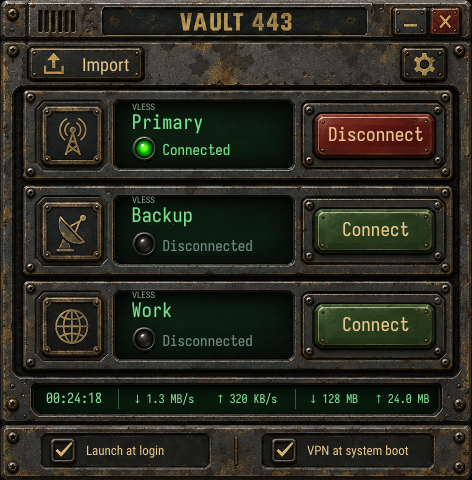
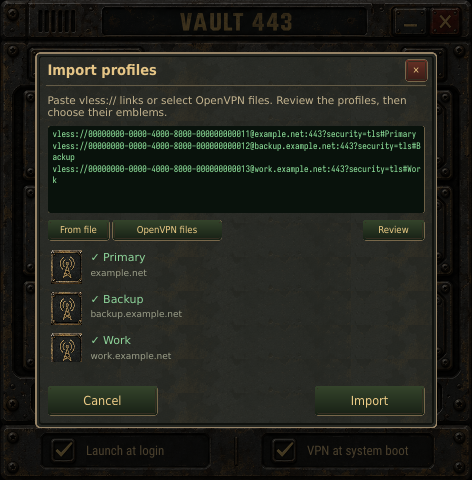
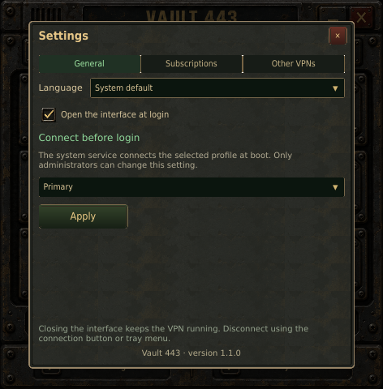
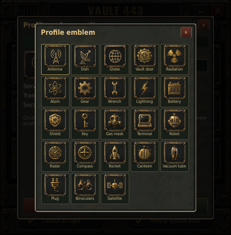
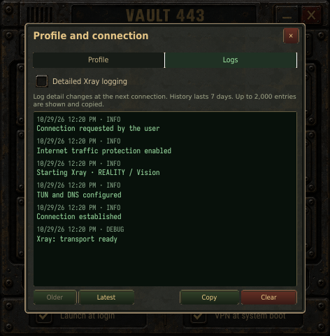
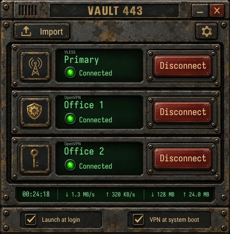
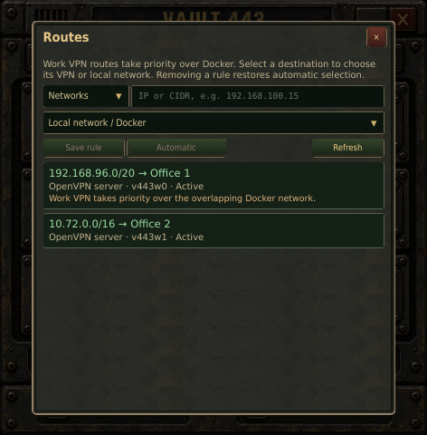

<p align="center">
  
</p>
<h1 align="center">Vault 443</h1>
<p align="center"><strong>A retro terminal for modern VLESS connections.</strong></p>
<p align="center">
  A native Ubuntu VPN client with worn brass, green phosphor, and one-click connections.<br>
  Qt Quick on the desktop. Go behind the scenes. VLESS and work OpenVPN in one place.
</p>
<p align="center">
  
  
  
  
</p>
<p align="center">
  <a href="#install">Install</a> ·
  <a href="#first-connection">Get started</a> ·
  <a href="#working-alongside-other-vpns">Other VPNs</a> ·
  <a href="#build-from-source">Build</a> ·
  <a href="docs/RELEASE-1.1.0.md">What's new</a>
</p>
<p align="center">
  <a href="docs/images/readme/main.png"></a>
</p>
<p align="center"><em>A compact 472 × 480 window. Real controls, live status, no browser runtime.</em></p>

## Your connections, in one place

- **Connect with one click.** After an administrator grants access once, everyday connections need no password prompt. Watch connection stages, cancel a pending attempt, or disconnect from the tray.
- **Bring your own profiles.** Import VLESS links, text files, Base64 lists, or HTTPS subscriptions. Review entries and choose from 23 emblems before saving. Subscription updates retain your choices.
- **Connect your work VPNs.** Import self-contained `.ovpn` files, run several work connections alongside VLESS, and choose how overlapping work and Docker networks are routed. Each profile has its own status, cancel button, and journal.
- **Keep control when the tunnel fails.** The network guard blocks direct Internet traffic during recovery, including forwarded Docker bridge traffic. Explicitly disconnect to restore ordinary routing.
- **Keep local networks reachable.** Attached LANs and verified work VPN routes retain their paths. IPv4 and IPv6 are checked separately; unavailable tunnel IPv6 fails quickly so applications can fall back to IPv4.
- **Start the way you want.** Launch the interface at login, connect a selected system profile at boot, or use both. Closing the window leaves the VPN running.
- **Track your session.** One line shows session time, download/upload speed, and accumulated transfer totals. Counters live in the service, survive closing the GUI and automatic reconnection, and reset for a new manual connection or service restart.
- **See what happened.** Per-profile connection logs retain up to seven days of history, with optional detailed logging. English and Russian interfaces switch instantly without reconnecting.

A valid VLESS or supported OpenVPN server profile is required. Vault 443 does not provide a VPN service or require its own account. Supported transports and import limits are documented in [service and profile behavior](docs/backend.md#supported-imports) and [work VPN details](docs/work-vpn.md).

## A closer look

<table>
  <tr>
    <td align="center"><a href="docs/images/readme/import.png"></a><br><strong>Review before importing</strong></td>
    <td align="center"><a href="docs/images/readme/settings.png"></a><br><strong>Your language, your startup</strong></td>
  </tr>
  <tr>
    <td align="center"><a href="docs/images/readme/icons.png"></a><br><strong>Give each profile an emblem</strong></td>
    <td align="center"><a href="docs/images/readme/logs.png"></a><br><strong>Follow every connection</strong></td>
  </tr>
</table>

<table>
  <tr>
    <td align="center"><a href="docs/images/readme/work-vpns.png"></a><br><strong>Internet and work, together</strong></td>
    <td align="center"><a href="docs/images/readme/work-routes.png"></a><br><strong>Resolve overlapping networks</strong></td>
  </tr>
</table>

All screenshots use the application's demo mode and contain fictional profiles.

## Install

Install a locally built `.deb` from `dist/`. Run these commands in your **normal desktop user's terminal**:

```sh
sudo apt install ./dist/vault443_1.1.0_amd64.deb
sudo vault443-access "$USER"
```

For ARM64, use `vault443_1.1.0_arm64.deb`. The access command is a one-time setup per local user; an existing Vault 443 account keeps its permissions. Open **Vault 443** from the application launcher afterward. The GUI runs as your regular user, and the service checks current group membership on each request.

**Updating Vault 443:** use the same APT command. Updates from **1.0.0 onward** preserve profiles, subscriptions, logs, group membership and startup settings. The service may briefly restart and resumes the requested connection under the traffic guard. Earlier VLESS Terminal installations must first complete their transition using the **1.0.0 release tools**; this source tree no longer includes that migration.

**Release status:** 1.1.0 adds managed OpenVPN connections and explicit route/DNS choices. It keeps the pinned Xray core unchanged. The project uses isolated networking and desktop validation on Ubuntu 24.04 and 26.04 amd64; ARM64 packages are cross-compiled and still require device acceptance. The bundled [Xray 26.9.30](https://github.com/XTLS/Xray-core/releases/tag/v26.9.30) is an upstream **prerelease**, pinned with [archive checksums](packaging/xray-lock.json). See the [validation record](docs/VALIDATION.md) for tested scenarios and remaining limitations.

### First connection

1. Open **Import**, paste one or more `vless://` links or choose a text file, then review the profiles and select their emblems. Add an HTTPS subscription from **Settings → Subscriptions**.
2. Click **Connect**. The line below the profile name shows progress, recovery attempts, or a specific error. Click it to open diagnostics.
3. Click the profile emblem to rename it, choose another emblem, or open **Logs**. Detailed logging takes effect on the next connection.

In **Settings → General**, choose **System default**, **English**, or **Русский**. System default uses the first supported language in your system preferences and falls back to English. The choice is saved per user and applies immediately, including the tray.

| Startup option | What it does |
| --- | --- |
| Launch the interface at login | Opens the GUI when this user signs in. It does not select a boot VPN profile. |
| Connect VPN at system boot | Starts the selected system profile before desktop login. Requires an authorized administrator. |

One owner controls the active set of connections: one VLESS session and up to 16 work OpenVPN sessions. Each user has a private profile library and journal. Operator access requires an active local desktop session. Boot-profile and manual VPN binding changes additionally require membership in `sudo` or `admin`.

## Work OpenVPN profiles

Choose **Import → OpenVPN files**, review the detected profiles, choose their emblems, and save. Each OpenVPN card has its own **Connect**, **Cancel**, and **Disconnect** action. Work VPNs start manually; closing the GUI does not disconnect them. They recover after a network interruption or service restart in the same OS boot, but do not start automatically after reboot.

This release accepts certificate-based TUN profiles with inline CA, client certificate, private key, and optional `tls-auth` / `tls-crypt`. Passwords, encrypted private keys, MFA/SSO, external credential files, TAP, user scripts and plugins are not supported. An unsupported directive produces a specific import error instead of being silently ignored.

Open **Settings → Other VPNs → Routes** to inspect received networks, overlaps and DNS zones. Work routes take precedence over overlapping Docker networks. A rule can select a work profile for an IP/CIDR, or preserve access to an existing local/Docker subnet. If two work profiles claim the same prefix or DNS zone, select the intended provider explicitly. Physical Internet bypass rules are not allowed.

The bottom traffic panel continues to measure **VLESS only**. Per-work-profile diagnostics show its interface, routes, DNS and connection stages. During an unexpected work VPN outage, its known destinations stay blocked until recovery; **Disconnect** releases that profile's protection.

| Work routing | Behavior |
| --- | --- |
| Specific work networks | Work VPN carries those networks; VLESS continues to carry Internet traffic. |
| Work subnet overlaps Docker | Work route wins automatically; the Routes window can preserve selected local destinations. |
| Same prefix or DNS zone claimed twice | Existing choice is retained; the conflict is displayed for explicit resolution. |
| Full Internet tunnel | VLESS pauses and resumes when the full tunnel is released. |

[Work VPN details and limitations](docs/work-vpn.md).

## Working alongside other VPNs

Connect Pritunl normally, then open **Settings → Other VPNs**. Automatically verified tunnels need no manual binding. Vault 443 also recognizes supported NetworkManager, systemd OpenVPN, and WireGuard connections from process and interface metadata.

| Other VPN's routing | Vault 443 behavior |
| --- | --- |
| Work networks only, such as a split-tunnel Pritunl profile | Work routes stay with Pritunl; VLESS carries Internet traffic. |
| All Internet traffic, such as a full-tunnel Pritunl profile | The requested VLESS connection pauses. Internet stays on the verified other VPN; VLESS resumes when those routes are released. |
| Tunnel identity cannot be verified | Diagnostics explains the problem. An administrator can use the advanced manual binding form for a supported custom tunnel. |

The application does not rewrite Pritunl settings or force it into split-tunnel mode. Verification is repeated when the network changes; a reused name such as `tun0` never grants trust by itself. Corporate DNS suffixes may need explicit configuration in the compatibility settings. Ordinary physical unicast DNS is blocked while protection is active; local IP access and mDNS remain available.

## Under the hood

| Layer | Responsibility |
| --- | --- |
| **Qt 6 Quick / QML · C++20** | Native window, textured controls, translations, tray, and asynchronous D-Bus client. No root GUI or Go–Qt bindings. |
| **Go system service** | Authenticated per-user profile access, subscriptions, connection lifecycle, recovery, and journal storage. |
| **OpenVPN 2.6+ · distribution package** | Managed certificate-based work tunnels, private management sockets and validated route/DNS events. |
| **Xray-core · separate process** | VLESS, REALITY/Vision, supported transports, and TUN traffic. |
| **systemd · nftables · systemd-resolved** | Boot startup, application-owned routes and traffic guard, and DNS integration. |

The guard remains active if Xray or the supervisor crashes. **Disconnect** is the explicit way to release it. When boot autoconnect is configured, an early guard runs before NetworkManager or systemd-networkd; other network managers are outside the validated boot contract.

Connection checks use certificate-verified HTTPS through the tunnel. Per-profile journals redact known credentials and retain at most **7 days / 10 MiB per profile / 50 MiB per user**. Xray access logging stays disabled. See the [service design](docs/backend.md) and [D-Bus contract](docs/interfaces.md) for details.

## Build from source

Use Go **1.22+**, CMake **3.21+**, a C++20 compiler, Ninja, and Qt **6.4+**. On Ubuntu 24.04, install the native build dependencies:

```sh
sudo apt install build-essential cmake ninja-build pkg-config golang-go \
  qt6-base-dev qt6-declarative-dev qt6-l10n-tools qt6-wayland qt6-qpa-plugins \
  qml6-module-qtquick qml6-module-qtquick-controls qml6-module-qtquick-layouts \
  qml6-module-qtquick-window qml6-module-qtquick-templates \
  qml6-module-qtquick-dialogs qml6-module-qtqml qml6-module-qtqml-workerscript
bash scripts/build.sh
./build/vault443 --demo
```

Demo mode uses fictional data and does not contact the system service or change networking. To preview a larger window, add `--scale 0.75` for 708 × 720 logical pixels. The default scale is `0.5`.

If you prefer local development dependencies without installing Qt system-wide, use `python3 scripts/bootstrap-qt.py` with `python3-apt` available, then source `scripts/qt-env.sh`. The [frontend guide](ui/README.md) covers translations, screenshots, and desktop tests.

Build distributable packages from the repository root:

```sh
python3 scripts/fetch-xray.py
bash scripts/package.sh amd64

# ARM64: Docker cross-builder with native host tools and an ARM64 Qt sysroot.
bash scripts/cross-build-arm64.sh
BUILD_DIR=build-arm64 bash scripts/package.sh arm64
```

The root `VERSION` file is the single release-version source for Qt, the Go daemon, and packaging.

Packaging verifies binary architecture and rejects local development-library RPATHs. Qt translations are compiled into the executable; no separate language pack is required.

### Development checks

```sh
ctest --test-dir build --output-on-failure
GOMODCACHE="$PWD/.cache/go-mod" GOCACHE="$PWD/.cache/go-build" \
  XRAY_TEST_BINARY="$PWD/.cache/xray/amd64/xray" go test -race ./...
bash scripts/test-gui-dbus.sh
```

GUI tests use demo data; D-Bus tests start a private fixture. Networking tests use explicitly isolated containers. Follow the [E2E runner guide](tests/e2e/README.md) and [frontend test guide](ui/README.md); do not run privileged network fixtures on your host network. The [validation record](docs/VALIDATION.md) distinguishes automated checks from remaining physical-device, desktop, and boot acceptance.

## Troubleshooting and recovery

Start with the profile's status line, **Diagnostics**, and **Logs**. If the service is unavailable, inspect:

```sh
journalctl -u vault443.service
systemctl status vault443-guard.service
```

A failed connection keeps the network guard armed. First try **Disconnect** in the GUI. If the service cannot recover and you explicitly want ordinary networking back:

```sh
sudo systemctl stop vault443.service
sudo vault443d --release-network
```

This removes only Vault 443's network resources, clears the desired connection and boot selection, and keeps saved profiles. Package removal performs the same explicit release. Purging intentionally retains `/var/lib/vault443`, which contains private profile data; erase it separately only if you intend to delete those credentials.

## Documentation and third-party components

- [1.1.0 release notes](docs/RELEASE-1.1.0.md) — managed OpenVPN work profiles and route selection.
- [1.0.1 release notes](docs/RELEASE-1.0.1.md) — single-line traffic counters and source cleanup.
- [1.0.0 release notes](docs/RELEASE-1.0.0.md) — the Vault 443 baseline.
- [Service and profiles](docs/backend.md) · [D-Bus API](docs/interfaces.md) · [Qt frontend](ui/README.md).
- [Validation record](docs/VALIDATION.md) — completed checks and known limits.
- [Xray-core](https://github.com/XTLS/Xray-core) is distributed as a separate executable under [MPL-2.0](https://github.com/XTLS/Xray-core/blob/v26.9.30/LICENSE); its license is included in the package. Qt uses the distribution's dynamically linked libraries.
- [Iosevka license](assets/fonts/Iosevka-LICENSE.md), [Roboto Condensed license](assets/fonts/Roboto-LICENSE.txt), and [font provenance](assets/fonts/manifest.json) are included in the repository.

No game assets or Bethesda logos are bundled. The repository does not yet define a project-wide license; third-party component licenses do not grant a license to the whole application.
