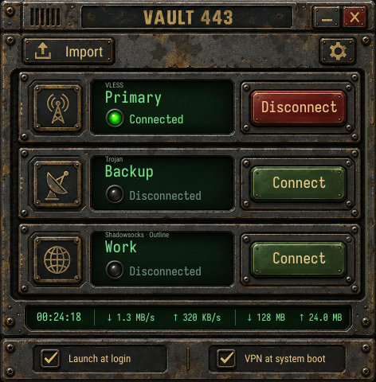
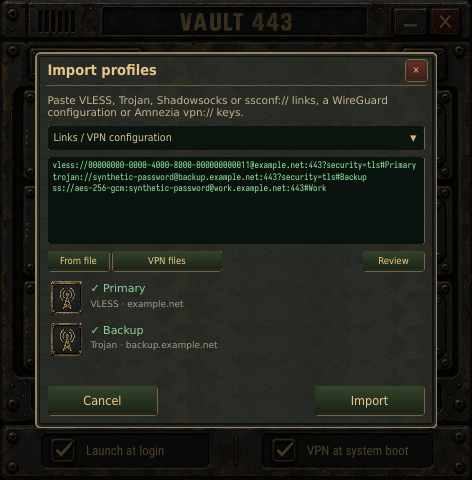
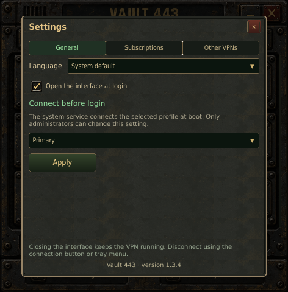
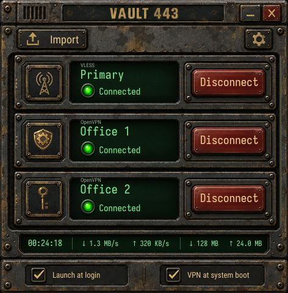
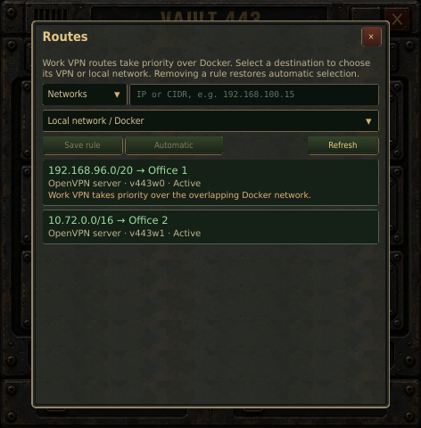
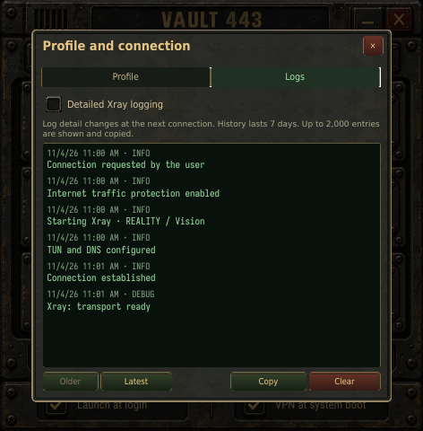
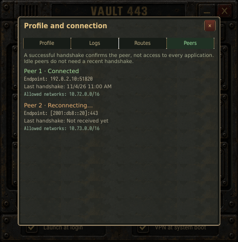

<p align="center">
  
</p>
<h1 align="center">Vault 443</h1>
<p align="center"><strong>VPN-клиент для Windows и Linux с ретро-интерфейсом, вдохновлённым Fallout.</strong></p>
<p align="center"><a href="README.md">English</a> · <strong>Русский</strong></p>
<p align="center"><a href="https://realleo.github.io/vault443/ru/"><strong>Откройте интерактивный пульт Vault 443</strong></a></p>
<p align="center">
  Импортируйте свои профили, подключайтесь одним нажатием и управляйте интернет- и рабочими VPN в одном компактном приложении.<br>
  VLESS, Trojan, Shadowsocks/Outline, OpenVPN, WireGuard и AmneziaWG.<br>
  Для подключения нужен ваш сервер или подписка. Аккаунт Vault 443 не требуется.
</p>
<p align="center">
  
  
  
  
  <a href="LICENSE"></a>
</p>
<p align="center">
  <a href="https://github.com/RealLeo/vault443/releases/download/1.3.5/Vault443-1.3.5-windows-x64-setup.exe"><strong>Скачать для Windows</strong></a> ·
  <a href="https://github.com/RealLeo/vault443/releases/download/1.3.5/vault443_1.3.5-1ubuntu24.04_amd64.deb"><strong>Скачать для Ubuntu</strong></a> ·
  <a href="#download">Все загрузки</a> ·
  <a href="#install">Установка</a> ·
  <a href="#first-connection">Первое подключение</a> ·
  <a href="docs/RELEASE-1.3.5.md#русский">Что нового</a>
</p>
<p align="center">
  <a href="docs/images/readme/main.png"></a>
</p>
<p align="center"><em>Компактное окно 472 × 480. Нативный интерфейс Qt Quick с живым состоянием подключения.</em></p>

## Ваши подключения в одном месте

- **Свои профили и подписки.** Импортируйте ссылки, файлы и HTTPS-подписки VLESS, Trojan и Shadowsocks/Outline. Проверяйте профили перед сохранением; обновление подписки сохраняет выбранные настройки оформления.
- **Интернет и работа.** Добавляйте поддерживаемые профили OpenVPN, WireGuard и AmneziaWG, управляйте пересекающимися рабочими и Docker-сетями. Рабочие маршруты могут использоваться одновременно с основным интернет-подключением; рабочий VPN с полным туннелем приостанавливает его.
- **Понятное состояние.** Следите за этапами подключения, трафиком и журналами каждого профиля. При неожиданном обрыве сетевая защита блокирует прямой выход в интернет; явное отключение возвращает обычную маршрутизацию.

Vault 443 — клиент для ваших конфигураций, а не VPN-сервис. Нужен действующий профиль или подписка. [Поддерживаемые форматы](docs/backend.md#supported-imports) и [ограничения рабочих VPN](docs/work-vpn.md) описаны в технической документации на английском.

<a id="download"></a>
## Скачать

**Vault 443 1.3.5 · Windows x64 и Linux.** Выберите систему и архитектуру: Ubuntu и Debian используют разные сборки.

| Система | Установщик | Контрольная сумма |
| --- | --- | --- |
| Windows 10 22H2 / Windows 11 · x64 | [Скачать .exe](https://github.com/RealLeo/vault443/releases/download/1.3.5/Vault443-1.3.5-windows-x64-setup.exe) | [SHA-256](https://github.com/RealLeo/vault443/releases/download/1.3.5/Vault443-1.3.5-windows-x64-setup.exe.sha256) |
| Ubuntu 24.04 / 26.04 · x64 | [Скачать .deb](https://github.com/RealLeo/vault443/releases/download/1.3.5/vault443_1.3.5-1ubuntu24.04_amd64.deb) | [SHA-256](https://github.com/RealLeo/vault443/releases/download/1.3.5/vault443_1.3.5-1ubuntu24.04_amd64.deb.sha256) |
| Ubuntu 24.04 · ARM64 | [Скачать .deb](https://github.com/RealLeo/vault443/releases/download/1.3.5/vault443_1.3.5_arm64.deb) | [SHA-256](https://github.com/RealLeo/vault443/releases/download/1.3.5/vault443_1.3.5_arm64.deb.sha256) |
| Debian 13 · x64 | [Скачать .deb](https://github.com/RealLeo/vault443/releases/download/1.3.5/vault443_1.3.5-1debian13_amd64.deb) | [SHA-256](https://github.com/RealLeo/vault443/releases/download/1.3.5/vault443_1.3.5-1debian13_amd64.deb.sha256) |
| Fedora 44 · x64 · первоначальный порт | [Скачать .rpm](https://github.com/RealLeo/vault443/releases/download/1.3.5/vault443-1.3.5-1.fc44.x86_64.rpm) | [SHA-256](https://github.com/RealLeo/vault443/releases/download/1.3.5/vault443-1.3.5-1.fc44.x86_64.rpm.sha256) |
| Arch Linux · x64 · первоначальный порт | [Скачать .pkg.tar.zst](https://github.com/RealLeo/vault443/releases/download/1.3.5/vault443-1.3.5-1-x86_64.pkg.tar.zst) | [SHA-256](https://github.com/RealLeo/vault443/releases/download/1.3.5/vault443-1.3.5-1-x86_64.pkg.tar.zst.sha256) |

[Все файлы релиза и манифесты сборок](https://github.com/RealLeo/vault443/releases/tag/1.3.5) · [SHA256SUMS](https://github.com/RealLeo/vault443/releases/download/1.3.5/SHA256SUMS).

Windows не требует отдельной установки Qt, Go, VPN-движков или драйвера. Приложение и установщик не подписаны: `Vault 443` указан в метаданных издателя, но не является подтверждённым Authenticode-издателем. ARM64 проверяется в эмуляции, не на физическом устройстве; см. [отчёт 1.3.5](docs/RELEASE-1.3.5.md#validation).

Основная проверенная настольная система Linux — Ubuntu. Fedora и Arch пока имеют статус первоначальных портов. Приёмка на физических рабочих столах, загрузка и выход из сна, а также SELinux в enforcing-режиме и firewalld на Fedora остаются отдельными проверками. Пакеты проекта не подписаны и не входят в официальные репозитории дистрибутивов. [Требования и границы проверки](docs/linux-packages.md).

<a id="install"></a>
## Установка

### Windows

1. Скачайте Windows EXE и его файл `.sha256`. Получите хеш в PowerShell:

   ```powershell
   Get-FileHash .\Vault443-1.3.5-windows-x64-setup.exe -Algorithm SHA256
   ```

   Сравните результат с содержимым скачанного файла контрольной суммы.
2. Запустите установщик из обычного сеанса Windows и подтвердите UAC. Выберите локальный диск и папку приложения, например `D:\Apps\Vault443`; по умолчанию — `C:\Program Files\Vault443`. Установщик защищает свои файлы и отклоняет небезопасные и сетевые пути, junction и символические ссылки. Обновление сохраняет прежний каталог.
3. Откройте **Vault 443** из меню **«Пуск»**. Окно работает от обычного пользователя, служба `Vault443` — от LocalSystem. Qt/QML, VPN-движки и официальный подписанный Wintun уже включены.

Профили и журналы хранятся в приватном `%ProgramData%\Vault443`, отдельно от папки приложения. Административные действия при необходимости запрашивают UAC. После автоматической установки от SYSTEM первый запуск может отдельно запросить доступ. [Руководство Windows](docs/WINDOWS-USER-GUIDE.md).

### Linux

1. Скачайте установщик и соответствующий файл `.sha256`. Откройте терминал в каталоге с обоими файлами от имени **обычного пользователя рабочего стола**.
2. Проверьте контрольную сумму. Например, для Ubuntu:

   ```sh
   sha256sum -c vault443_1.3.5-1ubuntu24.04_amd64.deb.sha256
   ```

   Результат должен содержать `OK`. Для другого дистрибутива укажите имя его файла `.sha256`. Другой вариант: скачайте [SHA256SUMS](https://github.com/RealLeo/vault443/releases/download/1.3.5/SHA256SUMS) в тот же каталог и выполните `sha256sum --ignore-missing -c SHA256SUMS`; убедитесь, что проверен именно ваш пакет и результат — `OK`.
3. Выполните команду для своей системы:

   ```sh
   # Ubuntu 24.04 / 26.04
   sudo apt install ./vault443_1.3.5-1ubuntu24.04_amd64.deb

   # Ubuntu 24.04 ARM64: вместо x64-пакета
   sudo apt install ./vault443_1.3.5_arm64.deb

   # Debian 13
   sudo apt install ./vault443_1.3.5-1debian13_amd64.deb

   # Fedora 44
   sudo dnf install ./vault443-1.3.5-1.fc44.x86_64.rpm

   # Arch Linux: сначала полное обновление системы
   sudo pacman -Syu
   sudo pacman -U ./vault443-1.3.5-1-x86_64.pkg.tar.zst
   ```

4. До первого подключения убедитесь, что система использует **systemd-resolved**: `systemctl is-active systemd-resolved` должен вывести `active`, а `resolvectl status` — показать сетевые настройки. Поддерживается стек systemd, D-Bus/logind и systemd-resolved с NetworkManager либо systemd-networkd. Необходимы WireGuard в ядре и `/dev/net/tun`. Установщик не переводит систему с другого DNS-сервиса автоматически; при необходимости выполните [настройку своего дистрибутива](docs/linux-packages.md#dns-and-desktop-prerequisites).
5. При первой установке на **Fedora или Arch** включите службы после подготовки DNS:

   ```sh
   sudo systemctl enable --now vault443-guard.service vault443.service
   ```

6. Один раз предоставьте доступ своему пользователю, затем откройте **Vault 443** из меню приложений:

   ```sh
   sudo vault443-access "$USER"
   ```

Окно приложения работает с правами обычного пользователя и требует активного локального сеанса. Не запускайте интерфейс через `sudo`. Ранее выданные права сохраняются. Значок в трее GNOME зависит от поддержки StatusNotifier/AppIndicator; без неё приложение можно повторно открыть из меню.

<a id="first-connection"></a>
## Первое подключение

1. Откройте **Импорт**, вставьте ссылки `vless://`, `trojan://`, `ss://`, `ssconf://` либо выберите текстовый файл. Проверьте профили, выберите эмблемы и сохраните. HTTPS-подписку можно добавить в настройках подписок.
2. Нажмите **Подключить**. Строка под названием профиля показывает этап подключения, попытки восстановления или конкретную ошибку. Нажатие на неё открывает диагностику.

Для обычной HTTPS-ссылки динамического Outline выберите тип **Outline · HTTPS / ssconf://** в окне импорта. В свойствах профиля доступно ручное обновление конфигурации; активное соединение продолжает использовать текущую конфигурацию.

Нажмите эмблему профиля, чтобы изменить название, выбрать одну из 23 эмблем или открыть журнал. Подробное логирование включается со следующего подключения.

В общих настройках выберите системный язык, **English** или **Русский**. Язык интерфейса и трея меняется сразу, без переподключения. Если системный язык не поддерживается, используется английский.

| Автозапуск | Поведение |
| --- | --- |
| Запуск интерфейса при входе | Открывает окно после входа пользователя; не выбирает профиль загрузочного подключения. |
| Подключение VPN при загрузке системы | Запускает выбранный основной профиль до входа в рабочий стол; требует прав уполномоченного администратора. |

Набором подключений управляет один владелец: одно основное интернет-подключение VLESS, Trojan либо Shadowsocks/Outline и до 16 рабочих подключений OpenVPN, WireGuard и AmneziaWG суммарно. Библиотеки профилей и журналы разделены по пользователям. Оператору нужен активный локальный сеанс. В Linux требуется членство в группе `vault443`, а для выбора загрузочного профиля и ручных привязок VPN — дополнительно `sudo`, `admin` либо `wheel`. В Windows доступ и административные действия подтверждаются через UAC.

## Ежедневное использование

Перетаскивайте латунные точки слева от эмблем, чтобы менять порядок профилей разных типов. Порядок сохраняется для каждого пользователя. Закрытие окна не отключает VPN: откройте приложение повторно из меню или используйте трей. Время сеанса, скорость и объёмы трафика сохраняются при закрытии интерфейса и автоматическом восстановлении соединения.

Подключённые локальные сети и проверенные рабочие маршруты сохраняют свои пути. IPv4 и IPv6 проверяются отдельно; если туннельный IPv6 недоступен, быстрый отказ позволяет приложениям перейти на IPv4.

Журналы отдельных профилей сохраняются до семи дней, с ограничениями 10 МиБ на профиль и 50 МиБ на пользователя. Из известных полей учётных данных удаляются секреты; access-логирование Xray отключено.

## Интерфейс

<table>
  <tr>
    <td align="center"><a href="docs/images/readme/import.png"></a><br><strong>Проверка перед импортом</strong></td>
    <td align="center"><a href="docs/images/readme/settings.png"></a><br><strong>Язык и автозапуск</strong></td>
  </tr>
  <tr>
    <td align="center"><a href="docs/images/readme/work-vpns.png"></a><br><strong>Интернет и работа</strong></td>
    <td align="center"><a href="docs/images/readme/work-routes.png"></a><br><strong>Управление маршрутами</strong></td>
  </tr>
  <tr>
    <td align="center"><a href="docs/images/readme/logs.png"></a><br><strong>Диагностика профиля</strong></td>
    <td align="center"><a href="docs/images/readme/peers.png"></a><br><strong>Состояние узлов</strong></td>
  </tr>
</table>

Скриншоты сделаны в демонстрационном режиме с вымышленными профилями. Здесь показан английский интерфейс; русский выбирается в настройках.

## Рабочие VPN и ограничения

Импортируйте самодостаточные файлы `.ovpn` или конфигурации WireGuard/AmneziaWG `.conf`; последние также можно вставить текстом. Поддерживается автономный экспорт Amnezia `vpn://`. Перед сохранением проверьте найденные профили и выберите эмблемы.

У каждой карточки есть отдельные действия подключения, отмены и отключения. Рабочие VPN запускаются вручную, продолжают работать после закрытия окна и восстанавливаются после сбоя сети или перезапуска службы в пределах одной загрузки ОС. После перезагрузки их нужно подключить снова.

**OpenVPN:** поддерживаются TUN-профили с сертификатами и встроенными CA, клиентским сертификатом, закрытым ключом и, при необходимости, `tls-auth` / `tls-crypt`. Пароли, зашифрованные закрытые ключи, MFA/SSO, внешние файлы учётных данных, TAP, пользовательские скрипты и плагины не поддерживаются. Неподдерживаемая директива вызывает конкретную ошибку импорта.

**WireGuard и AmneziaWG:** один или несколько узлов, IPv4/IPv6, PSK, DNS и MTU. В Linux WireGuard использует ядро, AmneziaWG — отдельный поставляемый Go-процесс без дополнительного DKMS-модуля. В Windows оба протокола используют поставляемые Go-движки и официальный Wintun. Сохраняются параметры AmneziaWG вплоть до 3.1. Соединение узла подтверждается рукопожатием; отказ одного узла не отключает остальные. Вкладка узлов показывает endpoints, последние рукопожатия и защищённые сети. Автономные экспорты Amnezia декодируются локально; подписки Premium/Free API и ключи администрирования сервера не поддерживаются.

В настройках других VPN откройте маршруты, чтобы увидеть сети, пересечения и DNS-зоны. Рабочие маршруты по умолчанию приоритетнее пересекающихся Docker-сетей. Можно назначить рабочий профиль для IP/CIDR или сохранить доступ к конкретной локальной/Docker-подсети. Одинаковые префиксы и DNS-зоны двух рабочих профилей требуют явного выбора. Правила прямого выхода в интернет через физический интерфейс не поддерживаются.

| Маршрутизация рабочего VPN | Поведение |
| --- | --- |
| Только определённые рабочие сети | Рабочие сети обслуживает рабочий VPN; интернет — основное подключение. |
| Пересечение с Docker | Рабочий маршрут выигрывает; нужные локальные назначения можно сохранить явно. |
| Одинаковый префикс или DNS-зона | Сохраняется предыдущий выбор, а конфликт предлагается разрешить явно. |
| Полный интернет-туннель | Основное подключение приостанавливается и возобновляется после освобождения полного туннеля. |

Нижняя панель трафика показывает **только основное интернет-подключение**. В диагностике рабочего профиля доступны интерфейс, маршруты, DNS и этапы соединения. При неожиданном обрыве известные назначения рабочего профиля остаются заблокированными до восстановления; явное отключение снимает его защиту. Установленный туннель не подтверждает авторизацию в каждом рабочем приложении. [Подробная документация](docs/work-vpn.md).

## Совместная работа с другими VPN

Подключите Pritunl обычным способом и откройте настройки других VPN. Автоматически проверенным туннелям не нужна ручная привязка. В Linux приложение также распознаёт поддерживаемые соединения NetworkManager, systemd OpenVPN и WireGuard по метаданным процессов и интерфейсов. В Windows официальные службы WireGuard могут проверяться автоматически; для остальных поддерживаемых VPN используются явные административные привязки.

| Сторонний VPN | Поведение Vault 443 |
| --- | --- |
| Только рабочие сети | Рабочие маршруты остаются на стороннем VPN, интернет идёт через основное подключение Vault 443. |
| Полный интернет-туннель | Основное подключение приостанавливается; интернет остаётся на проверенном стороннем VPN до освобождения его маршрутов. |
| Туннель не удалось подтвердить | Диагностика объясняет причину; администратор может вручную привязать поддерживаемый нестандартный туннель. |

Приложение не переписывает настройки Pritunl. Проверка повторяется при изменениях сети: одного имени вроде `tun0` недостаточно для доверия. Для корпоративных DNS-суффиксов может потребоваться явная настройка. Пока защита активна, обычный unicast DNS через физический интерфейс блокируется; доступ по локальным IP и mDNS сохраняется.

## Обновление и удаление

**Windows:** скачайте и проверьте новый EXE, затем установите поверх существующей версии. Каталог установки, профили и настройки сохраняются. Для переноса на другой диск или в другую папку удалите приложение и установите заново: приватные профили и журналы в `%ProgramData%\Vault443` сохраняются по умолчанию. Удаление доступно в **«Параметры → Приложения → Установленные приложения → Vault 443»**. Оно закрывает интерфейс и освобождает сетевые ресурсы приложения; если безопасно завершить операцию не удалось, файлы сохраняются для повторной попытки. [Подробности Windows](docs/WINDOWS-USER-GUIDE.md#обновление-и-удаление).

**Linux:** Скачайте новый пакет, проверьте сумму и повторите команду установки для своего дистрибутива. При обновлении с 1.3.0 сохраняются профили, подписки, журналы, права и автозапуск. Служба может ненадолго перезапуститься и восстановит запрошенное соединение под сетевой защитой. На Fedora и Arch ранее не запущенные службы не включаются автоматически при обновлении.

Старые установки **VLESS Terminal** сначала нужно перевести с помощью инструментов релиза **1.0.0**; в текущем дереве исходников этого переноса уже нет.

Удаляйте приложение пакетным менеджером:

```sh
sudo apt remove vault443       # Ubuntu / Debian
sudo dnf remove vault443       # Fedora
sudo pacman -R vault443        # Arch
```

Удаление освобождает сетевые ресурсы Vault 443, сохраняя посторонние правила, частные данные в `/var/lib/vault443`, членство в группе и настройки рабочего стола. Даже purge сохраняет частные профили; удалять их вручную следует только при намерении стереть учётные данные. Не используйте удаление файлов вручную, `--nodeps` или `--noscripts`: для очистки сети нужны штатные обработчики пакетного менеджера.

## Диагностика и восстановление сети

В Windows начните с журнала профиля и состояния службы `Vault443` в приложении **«Службы»**. Следующие команды systemd относятся к Linux. [Диагностика Windows](docs/WINDOWS-USER-GUIDE.md#диагностика).

Начните со строки состояния профиля, диагностики и журнала. Если служба недоступна:

```sh
journalctl -u vault443.service
systemctl status vault443-guard.service
```

При неудачном подключении сетевая защита остаётся активной, в том числе при аварии Xray или службы. Сначала попробуйте явно отключить соединение в интерфейсе. Если служба не восстанавливается и вы хотите вернуть обычную сеть:

```sh
sudo systemctl stop vault443.service
sudo vault443d --release-network
```

Команда освобождает только ресурсы Vault 443, сбрасывает желаемое подключение и выбор загрузочного профиля, но сохраняет сами профили. При загрузочном автоподключении ранняя защита запускается перед NetworkManager либо systemd-networkd; другие сетевые менеджеры не входят в проверенный сценарий загрузки.

## Устройство приложения и сборка

Интерфейс — Qt 6 Quick / QML и C++20; системная служба — Go. Xray-core, Outline SDK и AmneziaWG работают отдельными процессами. В Linux маршрутизацию и сетевую защиту обеспечивают systemd, nftables и systemd-resolved, IPC работает через D-Bus. В Windows используются SCM, IP Helper, WFP, NRPT и локальный DNS-координатор, а IPC — защищённые named pipes. Окно работает от обычного пользователя в обеих системах.

Для Windows используются MSVC 2022, закреплённый Qt 6.12.0 с опубликованным исправлением QtBase и Inno Setup 7.1.1; см. [сборку Windows](docs/WINDOWS.md). Для сборки Linux нужны Python 3.12+, CMake 3.21+, Ninja, компилятор C++20 и Qt 6.4+. Скрипты загружают отдельный проверяемый Go 1.27.3; системный Go не заменяется. Исходники и зависимости движков закреплены контрольными суммами. [Пошаговая сборка](README.md#build-from-source), [проверки разработки](README.md#development-checks) и [руководство по пакетам](docs/linux-packages.md#build-and-validate) приведены на английском.

Для предварительного просмотра собранного интерфейса без обращения к системной службе и изменения сети:

```sh
./build/vault443 --demo
```

Версия 1.3.5 выпускается для Windows x64, Linux x64 и Ubuntu ARM64. Бандл содержит закреплённый [Xray 26.9.30](https://github.com/XTLS/Xray-core/releases/tag/v26.9.30), который у upstream помечен как prerelease. Контейнерные тесты используют ядро хоста и не заменяют приёмку реального рабочего стола. [Протокол выполненных проверок](docs/VALIDATION.md).

## Лицензия и компоненты

Собственный код, документация и оригинальная графика Vault 443 доступны под [MIT](LICENSE), включая версию 1.3.5. Сторонние компоненты и шрифты сохраняют свои лицензии и не переводятся под MIT. Уведомления включены в пакеты в `/usr/share/doc/vault443/` на Linux и в `licenses/` папки приложения на Windows.

- [Xray-core](https://github.com/XTLS/Xray-core) — отдельный исполняемый файл под MPL-2.0.
- [AmneziaWG-Go](https://github.com/amnezia-vpn/amneziawg-go/tree/v3.1.20260828) — отдельный процесс под MIT с лицензиями зависимостей и манифестом сборки.
- Outline SDK и зависимости сопровождаются собственными уведомлениями и [закреплёнными исходниками](packaging/outline-lock.json).
- Qt подключается динамически: системные библиотеки на Linux, поставляемые Qt/QML на Windows. Лицензии шрифтов [Iosevka](assets/fonts/Iosevka-LICENSE.md) и [Roboto Condensed](assets/fonts/Roboto-LICENSE.txt) включены отдельно.

Ретро-интерфейс вдохновлён Fallout. Игровые ресурсы и логотипы Bethesda не включены.
